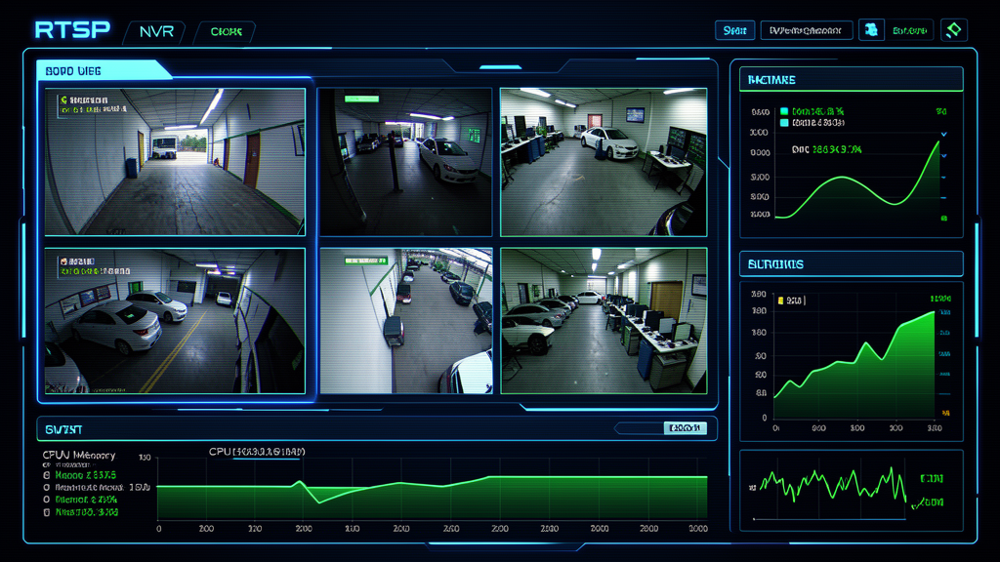
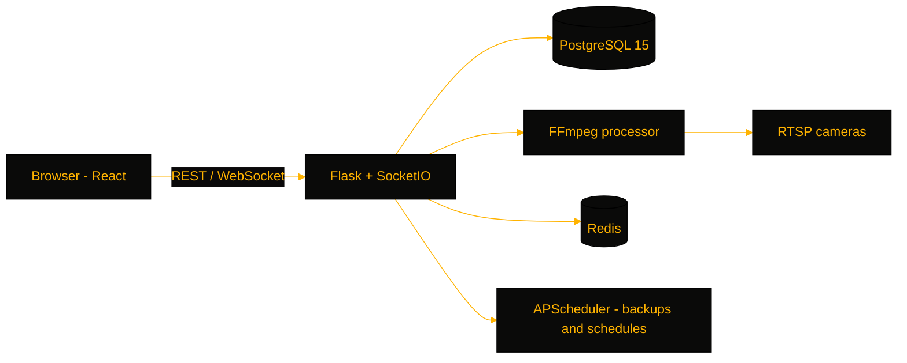

# SentryView

> Self-hosted RTSP NVR dashboard for IP cameras — live monitoring, scheduled recording, timeline review, and FFmpeg processing on your own hardware, for homelab and small-business operators.

[](https://github.com/OneByJorah/SentryView)
[](https://github.com/OneByJorah/SentryView)
[](https://github.com/OneByJorah/SentryView/stargazers)
[](https://github.com/OneByJorah/SentryView/commits)



## What This Is

SentryView is a network video recorder for RTSP cameras that keeps footage, metadata, and credentials inside your network. A Flask backend manages streams, recordings, events, and schedules; a React dashboard handles live viewing; an FFmpeg sidecar does the video work. It replaces proprietary cloud NVRs and per-camera licensing with a compose stack you run yourself.

## Quick Start

```bash
git clone https://github.com/OneByJorah/SentryView.git
cd SentryView
cp .env.example .env   # set POSTGRES_PASSWORD, SECRET_KEY, JWT_SECRET_KEY
docker compose up -d
```

Dashboard on `http://localhost:3000`, API on `http://localhost:5000`.

## Features

- Live RTSP stream viewing through the React dashboard
- On-demand and cron-style scheduled recording via an FFmpeg processor service
- Timeline review of recording start/stop, motion, audio, and connection events
- Multi-camera stream management with per-user ownership
- JWT authentication with registration, login, and password management
- Rate limiting and CORS via Flask-Limiter
- Overview analytics plus scheduled PostgreSQL backups in a dedicated container

## Architecture



Six services — `frontend`, `backend`, `db`, `redis`, `ffmpeg`, `backup` — run on a private bridge network.

## Stack

Flask 3, Flask-SocketIO, Flask-JWT-Extended, Flask-Limiter, PostgreSQL 15, Redis 7, APScheduler, FFmpeg, React 18, hls.js, Docker Compose

## Contributing

Contributions are welcome — see [CONTRIBUTING.md](CONTRIBUTING.md) and [open an issue](https://github.com/OneByJorah/SentryView/issues).

## License

MIT — see [LICENSE](LICENSE).
